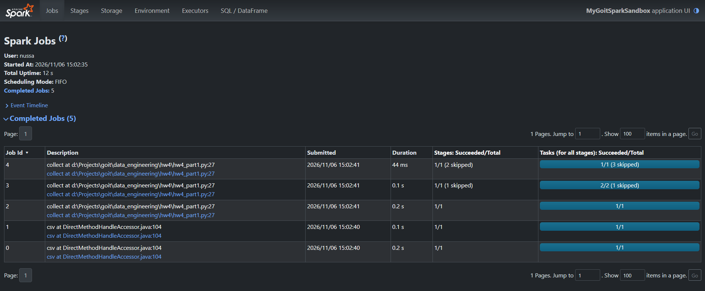
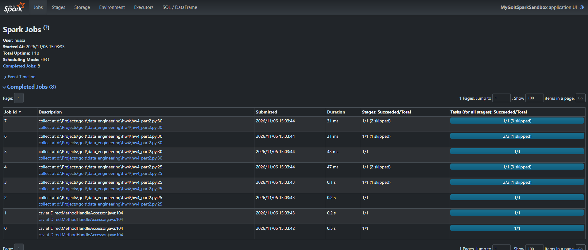
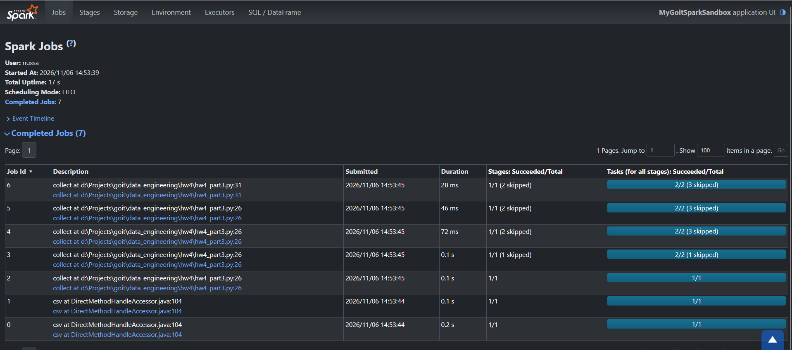

**1. Запустили скрипт hw4_part1.py.**

 

 **2. Запустили скрипт hw4_part2.py.**

 

*Питання: Чому при додаванні однієї проміжної дії nuek_processed.collect(), отримано аж на 3 Job більше?*

Через ліниві обчислення виконання всі операцій виконується лише в момент виклику collect. При виклику кожної collect() spark не запая'ятовує результат попередніх викликів і починає виконувати всі вказані трансформації знову. Через це на виконання всіх цих повторних транформацій було виділено ще 3 додаткових джоби.

**3. Запустили скрипт hw4_part3.py.**

 

*Питання: Чому при використанні cache() ми зменшили кількість Job?*

Метод cache() дозволяє зберегти проміжні результати обчислення в оперативну пам'ять і не виконувати їх знову. 
Тому, при виклику 1 collect - всі результати обчислюються і зберігаються, а при виклику другого - використовуються вже обчисленні результати (і тому створюється менше джоб).
